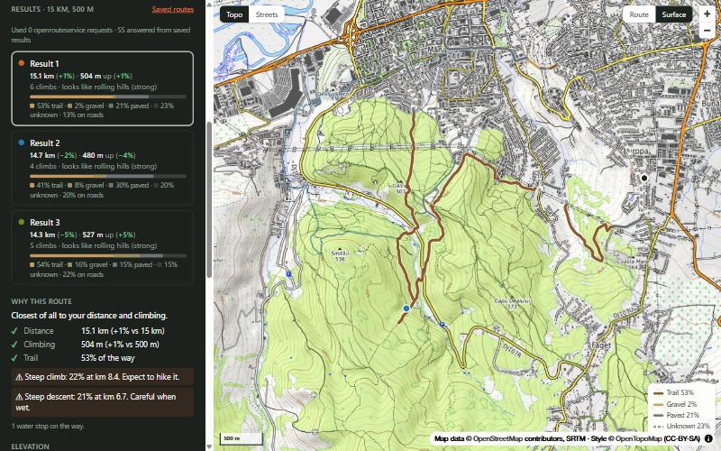
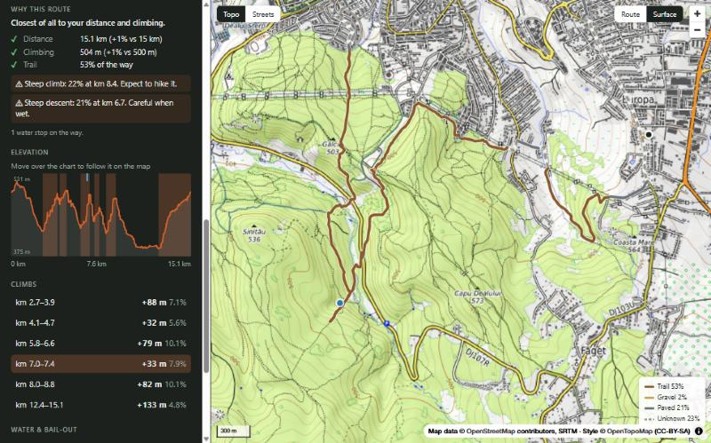
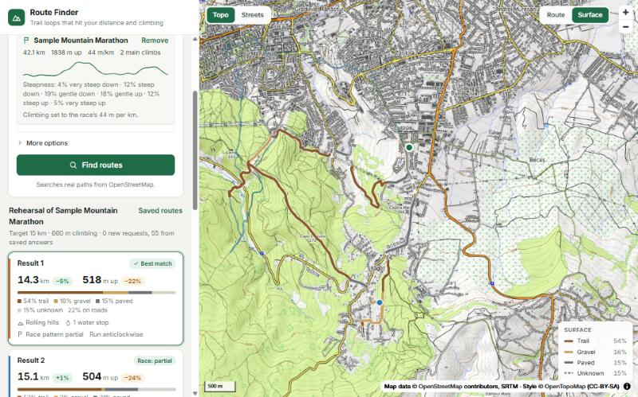
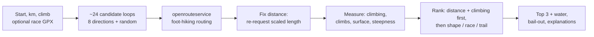

# Hillgorithm

**Loops built to your climb.** Trail and ultra running loops that hit your distance *and* your climbing target.

**Live:** [hillgorithm.vercel.app](https://hillgorithm.vercel.app/)

Give it a start point, a distance and how many metres you want to climb. It returns
three loops that match, tells you how much of each is real trail, where you can refill
water, and why it picked each one. Training for a mountain race? Upload the race GPX and
it finds local loops whose climbs and descents come in the same places.



## Why

Popular running apps show your climbing *while you draw* a route, or filter routes other
people made. I found none that **builds a loop to a climbing target**. The big route
planners are also increasingly behind subscriptions, and automatically suggested routes
tend to send trail runners down roads. This project goes after those gaps:

| Runners' complaint about other apps | What Hillgorithm does |
|---|---|
| Can't ask for "15 km with 500 m of climbing" | Searches dozens of loops and ranks them on both numbers |
| Suggested routes use busy roads | Shows trail / gravel / paved / road share and prefers trail |
| No water or bail-out info on loops | Lists fountains and springs along the way, distance back to the start, places to cut it short |
| Automatic routes are hard to trust | A "Why this route" card explains every ranking and warns about steep or risky stretches |
| Generic training for a specific race | Race rehearsal copies a race's climbs, descents and steepness onto local trails |

## Features

- **Exact distance and climbing.** Loops in 8 compass directions plus random round trips;
  each loop is re-requested with a corrected length until the distance fits.
- **Climb shape.** Prefer one long climb, rolling hills or hill repeats. The preference only
  chooses between routes that already hit your numbers, so it never trades away accuracy.
- **Trail share.** Every route shows how much is trail, gravel, paved or unknown, and how
  much is on roads with cars. The map can colour the route by surface.
- **Water and bail-out.** Drinking fountains, water points and springs within 150 m of the
  route, the longest stretch without water, how far from the start you get, and mid-run
  spots where the loop passes close to the start.
- **"Why this route."** Plain-language ranking reasons, ✓/✗ for each target, and warnings
  such as *"Steep descent: 21% at km 6.7. Careful when wet."*
- **Race rehearsal.** Upload a race GPX. Climbing is scaled to your training distance
  (same metres per km), and routes are scored on where the climbs come, where the descents
  come and how steep the race is. Loops are tried both ways round ("run it clockwise").
- **Elevation profile** linked to the map, a climb list, and **GPX download** for any watch.
- **Example searches** that load instantly, so the public site always shows real results.
- **Practice mode** for development: invented terrain, no API use.





## How it works

The AI never draws routes. A routing engine (openrouteservice, on OpenStreetMap data)
generates real candidate loops; plain code measures and ranks them.



- **Climbing** is counted with a 3 m threshold so GPS and elevation noise doesn't add fake
  metres, and one- or two-point elevation spikes are removed first.
- **Ranking** is two-step: find the most accurate route on distance + climbing; any route
  within 10 points of it is "close enough", and only among those do climb shape, race
  pattern and trail share decide.
- **Race matching** compares "climbing curves" (share of total climb done at each 2% of the
  distance), the same for descents, and the share of distance in 7 steepness bands.
- **Caching:** every routing answer is saved on disk, so repeating a search costs no API
  quota. One fresh search uses about 55 requests on the free plan.

## Real results

Live tests from Cluj-Napoca, Romania (15 km target):

| Start | Target climb | Best three loops |
|---|---|---|
| Forest edge | 500 m | 15.1 km / 504 m (+1% / +1%), 14.7 km / 480 m (−2% / −4%), 14.3 km / 527 m (−5% / +5%) |
| City centre | 500 m | Distance within 3%, climbing 26–36% short: the hills are further out than a 15 km loop can reach |

The app reports misses like the city-centre case honestly instead of hiding them.

## Getting started

You need [Node.js](https://nodejs.org/) 20 or newer and a free
[openrouteservice API key](https://openrouteservice.org/dev/#/signup).

```bash
npm install
cp .env.example .env      # then put your key in .env
npm run dev               # open http://localhost:3000
```

Tick **Practice mode** in the form to try everything without an API key or quota.

### Command line

```bash
node find-routes.mjs --lat 46.7420 --lon 23.5870 --km 15 --vert 500
node find-routes.mjs --km 15 --race samples/sample-mountain-marathon.gpx --practice
node analyze-gpx.mjs out/route-1.gpx      # climbs and shape of any GPX, no API calls
```

Options: `--shape long|rolling|repeats`, `--race file.gpx`, `--practice`, `--no-cache`,
`--headings 8 --candidates 8`. GPX files are written to `out/` (`out/practice/` in practice mode).

## Deploying (e.g. Vercel)

The app is a standard Next.js project, so any Node host works. On [Vercel](https://vercel.com/):

1. Push the project to a GitHub repository (`.env` stays out of it).
2. In Vercel, **Add New → Project**, import the repository, and keep the detected Next.js settings.
3. Under **Settings → Environment Variables**, add `ORS_API_KEY` (and optionally the limits below).
4. Deploy. The site opens on a ready-made example, so visitors see results straight away.

| Setting | Default | What it does |
|---|---|---|
| `ORS_API_KEY` | required | openrouteservice key, used only on the server |
| `SEARCHES_PER_HOUR` | 5 | real searches per visitor per hour |
| `DAILY_REQUEST_BUDGET` | 1500 | stop new searches after this many routing requests in a day (free plan ≈ 2,000) |
| `CACHE_DIR` | `.cache` (temp folder on Vercel) | where saved routing answers are kept |

Good to know:

- **Searches can take up to about 2 minutes** (openrouteservice allows ~40 requests a minute),
  so the host's time limit for server functions must allow that.
- **Limits and cache live in server memory / a temp folder.** On serverless hosting they reset
  now and then and each running copy counts separately: enough to stop accidents and casual
  abuse, not a hard guarantee. A shared store (e.g. Redis) would make them exact.
- **Practice mode is development-only**; visitors get the example searches instead.
- **Refresh the examples** after changing the engine: run the same searches once, then
  `node scripts/make-examples.mjs` (it reads from the cache, so it uses no quota).

### Tests

```bash
npm test
```

41 tests cover the route engine, climb detection, caching, race matching, surfaces,
water and bail-out, explanations and search limits, using a fake routing service.

## Project structure

```
app/                Next.js web app
  page.js           server: loads saved routes from out/
  api/find/route.js server: runs a search (API key never reaches the browser)
  RouteViewer.js    the screen: form, results, details
  MapView.js        MapLibre map (topo / streets, surface colours, water dots)
  ElevationProfile.js
src/
  engine.mjs        candidate loops, distance correction, ranking
  climbs.mjs        climb detection and climb-shape scores
  rehearsal.mjs     race patterns: climbing / descent curves, steepness mix
  surface.mjs       trail / gravel / paved / road breakdown
  water.mjs, water-sources.mjs, overpass.mjs   water along the route
  bailout.mjs       distance back to start, shortcut spots
  explain.mjs       "Why this route"
  ors-cache.mjs     disk cache for API answers
  fake-ors.mjs      practice mode: invented terrain
test/               node:test suites
samples/            a made-up 42 km mountain race GPX
```

**Stack:** Next.js 16, React 19, MapLibre GL 6, plain JavaScript, no database.

## Limitations

- Hill repeats are scored but rarely found: loops don't naturally repeat a climb. A
  dedicated "up and down the same hill" builder is the next step.
- Distances back to the start are straight lines; the real way back is longer.
- Surface and water data are only as good as OpenStreetMap in your area; untagged paths
  show as "unknown".
- The free openrouteservice plan allows a limited number of searches per day.

## Credits

- Routing, surfaces and points of interest: [openrouteservice](https://openrouteservice.org/)
- Map data © [OpenStreetMap](https://www.openstreetmap.org/copyright) contributors
- Topo tiles: [OpenTopoMap](https://opentopomap.org/) (CC-BY-SA) · Street tiles: [OpenFreeMap](https://openfreemap.org/)
- Water fallback: [Overpass API](https://wiki.openstreetmap.org/wiki/Overpass_API)
- Inspired by [trackscout.net](https://trackscout.net/)

Built as a portfolio and learning project.
